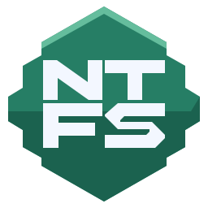
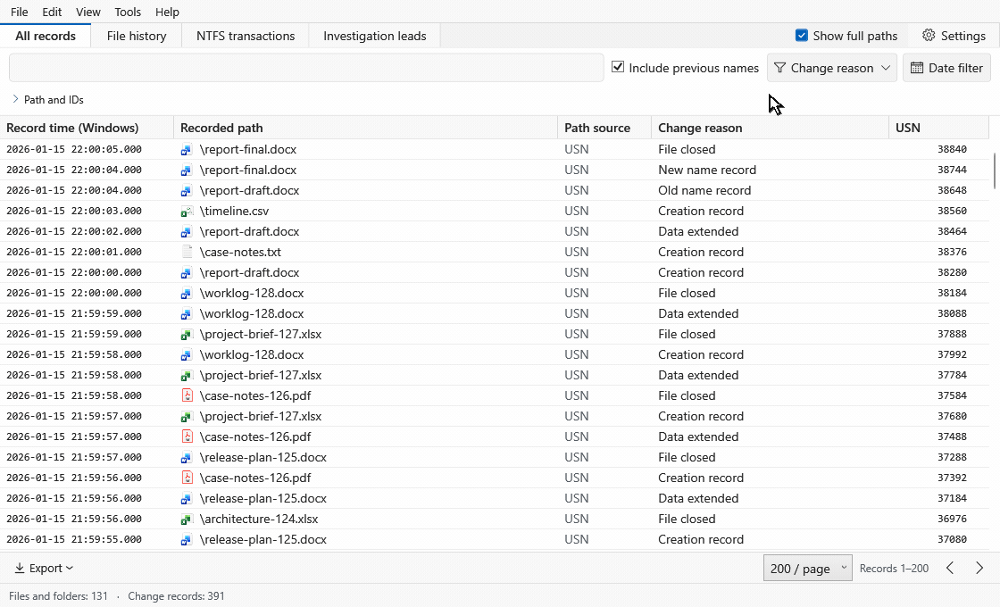

<p align="center">
  
</p>

<h1 align="center">NTFS Tracer</h1>

<p align="center"><strong>Search NTFS changes, trace a file's history, and verify the original bytes.</strong></p>

<p align="center"><strong><a href="https://github.com/absolroot/NTFS-Tracer/releases/latest">Download for Windows x64</a></strong> · <a href="#quick-start">Quick start</a> · <a href="#supported-inputs">Supported inputs</a> · <a href="#performance">Performance</a></p>

<p align="center"><a href="README.ko.md">한국어</a> · <a href="README.ja.md">日本語</a></p>

NTFS Tracer is a Windows workbench for the USN change journal, Master File Table, and NTFS transaction log. Exporting records, reapplying filters, and switching tools can interrupt an investigation. NTFS Tracer keeps search, file history, and source Hex together so an analyst can answer **what happened to this file, and which records show it?** The desktop app supports **16 interface languages** with live switching.

## From a search hit to the evidence

[](docs/media/investigation.gif)

**Search for `report` → open file history → compare both rename records → inspect Hex.** The v0.8.29 demo uses 391 synthetic records across 131 files. The new name is at offset `0x9758` within `$J`.

[Journal search](docs/media/journal-search.png) · [Rename history](docs/media/file-history.png) · [Source Hex](docs/media/source-hex.png)

## Quick start

1. Extract the Windows x64 ZIP and run **NtfsTracer.exe**. The shared-runtime ZIP requires **.NET 10 Windows Desktop Runtime (x64)**.
2. Open the source that matches your evidence.
   - **Extracted artifacts** · Choose **Select files…** or **Select extracted folder…**, then **Start analysis**. A `$J` alone is enough for USN history.
   - **Disk image** · Choose **Select files…**, select the NTFS volume and artifacts, then **Extract and analyze**.
   - **Tracker results** · Choose **File → Open Tracker results…**. For TSV, choose **All files** in the file picker.
3. Search **All records**, open **File history**, or switch to **NTFS transactions**. Select a record to inspect the source. **F1** opens the in-app guide.

## Supported inputs

### Disk and evidence images

| Format | Supported variants |
| --- | --- |
| RAW (`.raw`, `.img`, `.dd`) | NTFS volume or MBR/GPT disk. Consecutive split RAW sets start at `.000` or `.001`. |
| EnCase EWF (`.E01`, `.Ex01`) | Physical images. Select the first segment and keep the complete set together. Encryption and bzip2 are unsupported. |
| Logical EWF (`.L01`, `.Lx01`) | Select the first segment and choose artifacts from the collected file catalog. The same EWF limits apply. |
| QCOW / QCOW2 | Standalone QCOW1 and QCOW2 v2/v3 with standard L2 tables. Backing files, external data, and encryption are unsupported. |
| VHD / VHDX | Fixed and dynamic VHD and standalone VHDX. Differencing disks are unsupported. |
| VMDK | Single sparse, stream-optimized, and descriptors referencing FLAT extents in the same directory. Parent chains are unsupported. |
| AFF (`.aff`) | Single AFF1 with uncompressed, zlib, or zero pages |

Physical images must contain a readable NTFS volume. A locked BitLocker volume must be unlocked outside NTFS Tracer. See the [image module](https://github.com/absolroot/NTFS-Tracer/blob/v0.8.29/modules/EvidenceImage/README.md) for the full variant limits.

### Extracted artifacts and existing results

| Input | Use it for |
| --- | --- |
| `$J` / `$UsnJrnl:$J` | USN change search, file history, and investigation leads |
| `$MFT` from the same volume | Attach to `$J` or `$LogFile` to supplement paths using file and folder names recorded at acquisition |
| `$LogFile` | NTFS transactions, LSNs, and Redo/Undo payloads |
| NTFS Log Tracker SQLite, CSV or TSV | Browse and filter existing results in the read-only viewer |

You can also select a folder containing extracted artifacts. The app opens evidence read-only and writes extractions and indexes separately. New installations use `%LOCALAPPDATA%\NtfsTracer`. Existing JournalDesk settings and indexes can be reused.

## Investigation features

| Task | What you can check |
| --- | --- |
| Find a file | Search names, aliases, paths, file IDs and parent IDs. Refine USN results by time, reason, or exact USN. |
| Reconstruct an event | Follow one file through changes, compare the two sides of a rename or move, and see which path portions came from the journal or the acquired MFT. |
| Verify and export | Inspect fields, Hex, JSON, nearby records, or transaction LSNs and Redo/Undo data. Return to your search or export to CSV. |
| Examine incomplete evidence | Scan supplied files for candidate records. Check investigation leads and carving results against the source bytes. |

## Compare workflows

| Tool | Workflow it is suited to |
| --- | --- |
| **NTFS Tracer** | Interactive Windows investigation. Search the journal, trace one file across events, and verify the contributing records at their original offsets. |
| [MFTECmd](https://github.com/EricZimmerman/MFTECmd) | Command-line parsing and batch CSV/JSON exports across several NTFS artifacts. |
| [NTFS Log Tracker](https://sites.google.com/site/forensicnote/ntfs-log-tracker) | GUI-based NTFS event reconstruction, searches, and export. Open existing Tracker SQLite and CSV results in NTFS Tracer's read-only viewer. |
| [Velociraptor](https://docs.velociraptor.app/artifact_references/pages/windows.forensics.usn/) | Endpoint collection and VQL queries, including USN filtering and collection across hosts. |

## Performance

The Rust engine parses NTFS artifacts into reusable SQLite indexes. When indexing multiple sources, the app can start showing USN records once the journal index is ready, while MFT and transaction indexing continue. The investigation view pages through results and can reuse a verified path-sort cache.

### 16 file-reference lookups on 480,000 records

| Method | Index creation | Time to retrieve the records |
| --- | ---: | ---: |
| [Sootmark USN](https://github.com/Sootmark/usn) harness, all 16 references known in advance | — | **444 ms** in one pass |
| Sootmark USN harness, 16 separate lookups | — | **6.66 s** across 16 passes |
| **NTFS Tracer**, 16 indexed lookups | **2.67 s** once | **3.10 ms** after indexing |

For a known list, a single scan returns results without waiting for an index. A reusable index saves time when new questions come up during an investigation. All methods returned the same names, USNs, and source offsets. These are backend measurements from a synthetic journal. The comparison above describes workflows for MFTECmd, NTFS Log Tracker, and Velociraptor. [Measurement method and raw timings](docs/performance.md)

## Build from source

The desktop app uses C# and WPF and the indexing engine uses Rust. On Windows x64, install the .NET 10 SDK, the Rust MSVC toolchain, and Visual Studio C++ Build Tools. For linting, install `rustfmt` and `clippy`.

```powershell
cargo build --release --locked --manifest-path engine/Cargo.toml
dotnet publish gui/NtfsTracer.csproj -c Release -p:PublishProfile=Portable -o artifacts/portable
./lint.ps1
```

For EWF support, build `JournalDesk.libewf.dll` using the [libewf instructions](https://github.com/absolroot/NTFS-Tracer/blob/v0.8.29/modules/EvidenceImage/Logical/Native/README.md) before publishing.

[Rust engine](https://github.com/absolroot/NTFS-Tracer/tree/v0.8.29/engine) · [Index format](https://github.com/absolroot/NTFS-Tracer/blob/v0.8.29/engine/INDEX_FORMAT.md) · [WPF app](https://github.com/absolroot/NTFS-Tracer/tree/v0.8.29/gui) · [Regression tests](https://github.com/absolroot/NTFS-Tracer/tree/v0.8.29/tests)

## Third-party notices

[Dependency and redistribution notices](THIRD-PARTY-NOTICES.md)

## License

Project-owned code is available under the [PolyForm Noncommercial License 1.0.0](LICENSE). Commercial use requires prior written permission, including internal investigations at for-profit companies, paid client work, and inclusion in commercial products. For permission, [open a licensing inquiry](https://github.com/absolroot/NTFS-Tracer/issues/new) with a brief description of the intended use and a way to contact you. Keep case details and evidence out of the public issue.

Third-party components retain their own terms and may be used under those terms. See [third-party notices](THIRD-PARTY-NOTICES.md), including the terms and replacement instructions for libewf.
