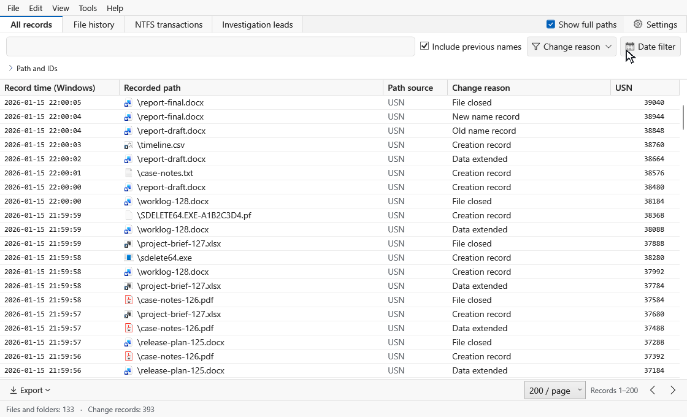
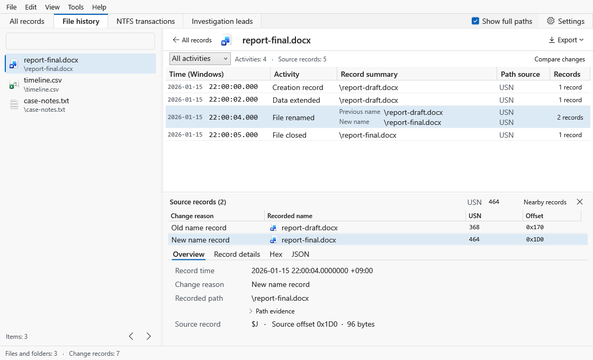

<p align="center">
  
</p>

<h1 align="center">NTFS Tracer</h1>

<p align="center"><strong>Faster NTFS log analysis. A clearer view of what changed.</strong></p>

<p align="center"><strong><a href="https://github.com/absolroot/NTFS-Tracer/releases/latest">Download for Windows x64</a></strong> · <a href="#quick-start">Quick start</a> · <a href="#investigation-features">Investigation features</a> · <a href="#supported-inputs">Supported inputs</a> · <a href="#investigation-examples-and-tool-comparisons">Investigation examples</a></p>

<p align="center"><a href="README.ko.md">한국어</a> · <a href="README.ja.md">日本語</a></p>

**NTFS Tracer is a Windows forensic tool for searching NTFS logs and tracing file changes from the records you find.** Its Rust engine indexes the USN journal and NTFS transaction log. File history shows renames, moves, and deletions in order. Each rename brings both names and their supporting USN records together. You can also open existing NTFS Log Tracker SQLite, CSV, and TSV results in read-only mode.

## Why use NTFS Tracer?

- **Open file history directly from a search result.** Find a file by its current name, then choose **Open file history** to see its previous name and the supporting records.
- **Optimized database setup, USN indexing, and filename search.** The Rust engine reads the USN journal and builds a searchable database. Typical filename searches start without a fixed delay. On the same sample USN journal, the time from starting analysis to seeing the first record list was **1.08 seconds** in the NTFS Tracer development build and **3.25 seconds** in NTFS Log Tracker 1.9. These are medians from ten runs per tool. [Benchmark setup and results](docs/performance.md#finding-a-previous-name-from-the-current-name)

Investigation tools include lead review, copying evidence values to the clipboard, CSV export, and saving work to resume later.

## Quick start

1. Extract the Windows x64 ZIP and run **NtfsTracer.exe**. The shared-runtime ZIP requires **.NET 10 Windows Desktop Runtime (x64)**.
2. Open the source that matches your evidence.
   - **Extracted artifacts** · Choose **Select files…** or **Select extracted folder…**, then **Start analysis**. A `$J` alone is enough for USN history.
   - **Disk image** · Choose **Select files…**, select the NTFS volume and artifacts, then **Extract and analyze**.
   - **Tracker results** · Choose **File → Open Tracker results…**. For TSV, choose **All files** in the file picker.
3. Search **All records**, open **File history**, or switch to **NTFS transactions**. Select an event to see its details and contributing records. **F1** opens the in-app guide.

Before closing the app, choose **File → Save investigation…**. On your next launch, choose **Resume last investigation** to return to the saved sources, search settings, and selected record. NTFS Tracer checks the source SHA-256 hashes and reuses compatible indexes.

## Investigation features

[](docs/media/full-app-walkthrough-timestamps.gif)

- **Search the change journal**. Find a file by its current or previous name, path, or reference number. Narrow the USN journal by time or change reason.
- **Follow one file through changes**. Open the file history from a search result. Review a rename or move and see the records that support each side. Paths filled in from the acquired MFT are labeled with their source.
- **Compare transaction values**. Find a record by LSN in the transaction log. Compare file timestamps when both Undo and Redo contain values.
- **Review investigation leads**. Review candidates such as repeated renames before deletion, SDelete-related records, or timestamp changes. Open the supporting records to assess the lead.

Inspect decoded fields, Hex, or JSON, export results to CSV, or scan source files for remnants of USN and transaction records.

## Supported inputs

### Disk and evidence images

| Format | Supported variants |
| --- | --- |
| RAW | `.raw`, `.img`, `.dd`. NTFS volume or MBR/GPT disk. Consecutive split RAW sets start at `.000` or `.001`. |
| EnCase EWF | `.E01`, `.Ex01`. Physical images. Select the first segment and keep the complete set together. Encryption and bzip2 are unsupported. |
| Logical EWF | `.L01`, `.Lx01`. Select the first segment and choose artifacts from the collected file catalog. The same EWF limits apply. |
| QCOW/QCOW2 | Standalone QCOW1 and QCOW2 v2/v3 with standard L2 tables. Backing files, external data, and encryption are unsupported. |
| VHD/VHDX | Fixed and dynamic VHD and standalone VHDX. Differencing disks are unsupported. |
| VMDK | Single sparse, stream-optimized, and descriptors referencing FLAT extents in the same directory. Parent chains are unsupported. |
| AFF | `.aff`. Single AFF1 with uncompressed, zlib, or zero pages |

Physical images must contain a readable NTFS volume. A locked BitLocker volume must be unlocked outside NTFS Tracer. See the [image module](https://github.com/absolroot/NTFS-Tracer/blob/v0.8.30/modules/EvidenceImage/README.md) for the full variant limits.

### Extracted artifacts and existing results

| Input | Use it for |
| --- | --- |
| `$J` / `$UsnJrnl:$J` | USN change search, file history, and investigation leads |
| `$MFT` from the same volume | Attach to `$J` or `$LogFile` to supplement paths using file and folder names recorded at acquisition |
| `$LogFile` | NTFS transactions, LSNs, and Redo/Undo payloads |
| NTFS Log Tracker SQLite, CSV or TSV | Browse and filter existing results in the read-only viewer |

You can also select a folder containing extracted artifacts. The app opens evidence read-only and writes extractions and indexes separately. New installations use `%LOCALAPPDATA%\NtfsTracer`. Existing JournalDesk settings and indexes can be reused.

<a id="compare-workflows"></a>
<a id="performance"></a>

## Investigation examples and tool comparisons

### Find a previous name from the current filename

You found `report-final.docx` in the collected evidence and want to know what it used to be called. We opened the same USN journal (`$J`) in both tools. NTFS records the two names in separate entries, so the investigation has to connect records for the same file.

| Tool | How we found the previous name |
| --- | --- |
|  **NTFS Tracer** | With **Include previous names** enabled, we searched for `report-final.docx` and chose **Open file history**. The search found five records for the file. Its history showed the old and new names together in one rename event. |
|  **[NTFS Log Tracker 1.9](https://sites.google.com/site/forensicnote/ntfs-log-tracker)** | We searched **File/Directory Name** for `report-final.docx` and found two records. We copied the **FileReferenceNumber**, the NTFS identifier for the file, cleared the name filter, and searched by that number. This returned five records, including the old name. |

Both tools identified **`report-draft.docx`** as the previous name. The NTFS Tracer screenshot shows the two names and the USN records that support the rename.

[](docs/media/file-history.png)

**Time to reach the previous name**

We ran the same steps on a separate synthetic journal (6.1 MB, 63,007 records). The figures are medians from ten automated runs per app on the same PC. They exclude file selection, human typing, and time spent reading the results.

| Result shown after starting analysis | NTFS Tracer development build | NTFS Log Tracker 1.9 |
| --- | ---: | ---: |
| First USN list for a fresh analysis | **1.08 s** | 3.25 s |
| Previous name of `report-final.docx` | **1.30 s** | 3.50 s |

[Setup and all ten measurements](docs/performance.md#finding-a-previous-name-from-the-current-name) · [Verify the demo filenames, USNs, and source offsets with MFTECmd](docs/performance.md#cross-checking-the-demo-with-mftecmd)

### Check file timestamps in a transaction

If a transaction in `$LogFile` looks relevant, you can check whether it changed a file’s creation or modification time. In NTFS Tracer, find the record by LSN (log sequence number) under **NTFS transactions** and check **File attribute timestamps** in the overview. When both Undo and Redo contain values, compare the creation, content modification, metadata change, and last access times before and after the change.

ArtiFast Windows documents a workflow in which you find the LSN in the Windows LogFile list and select the row to inspect the entry offset, transaction ID, and Redo/Undo operations. [ArtiFast's Windows LogFile example](https://forensafe.com/blogs/windowslogfile.html)

## Build from source

The desktop app uses C# and WPF and the indexing engine uses Rust. On Windows x64, install the .NET 10 SDK, the Rust MSVC toolchain, and Visual Studio C++ Build Tools. For linting, install `rustfmt` and `clippy`.

```powershell
cargo build --release --locked --manifest-path engine/Cargo.toml
dotnet publish gui/NtfsTracer.csproj -c Release -p:PublishProfile=Portable -o artifacts/portable
./lint.ps1
```

For EWF support, build `NtfsTracer.libewf.dll` using the [libewf instructions](https://github.com/absolroot/NTFS-Tracer/blob/main/modules/EvidenceImage/Logical/Native/README.md) before publishing.

[Rust engine](https://github.com/absolroot/NTFS-Tracer/tree/v0.8.30/engine) · [Index format](https://github.com/absolroot/NTFS-Tracer/blob/v0.8.30/engine/INDEX_FORMAT.md) · [WPF app](https://github.com/absolroot/NTFS-Tracer/tree/v0.8.30/gui) · [Regression tests](https://github.com/absolroot/NTFS-Tracer/tree/v0.8.30/tests)

## Display language

Choose from 16 interface languages under **View → Display language**. Changes apply immediately.

## Third-party notices

[Dependency and redistribution notices](THIRD-PARTY-NOTICES.md)

## License

Project-owned code is available under the [PolyForm Noncommercial License 1.0.0](LICENSE). Commercial use requires prior written permission, including internal investigations at for-profit companies, paid client work, and inclusion in commercial products. For permission, [open a licensing inquiry](https://github.com/absolroot/NTFS-Tracer/issues/new) with a brief description of the intended use and a way to contact you. Keep case details and evidence out of the public issue.

Third-party components retain their own terms and may be used under those terms. See [third-party notices](THIRD-PARTY-NOTICES.md), including the terms and replacement instructions for libewf.
