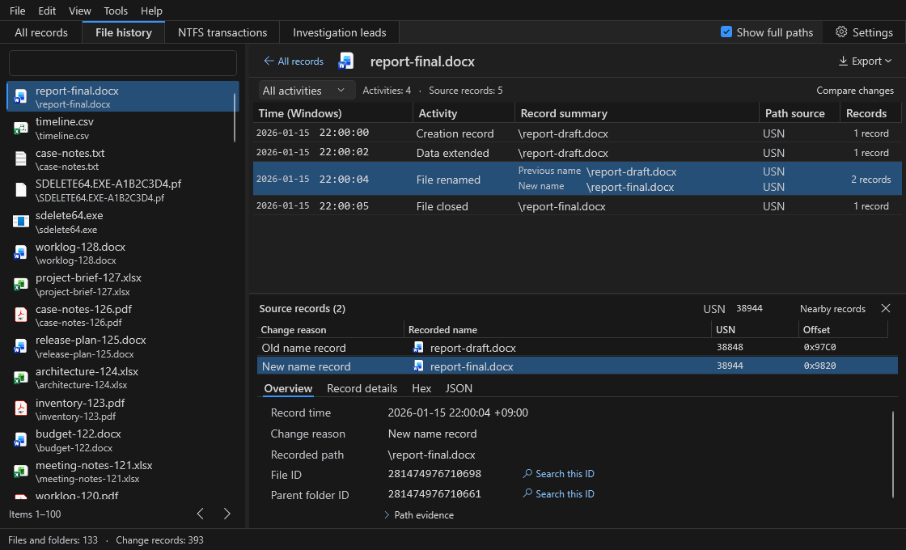

# NTFS Tracer

**NTFS ログ解析をもっと速く。ファイルの変化がひと目でわかる。**

**NTFS Tracer は、NTFS ログを検索し、見つけたレコードからファイルの変更履歴をたどる Windows 向けフォレンジックツールです。** Rust エンジンで USN ジャーナルと NTFS トランザクションログをインデックス化します。ファイル履歴では名前の変更、移動、削除を時系列で確認できます。名前の変更では、変更前後の名前とそれぞれの根拠となる USN レコードを一つの項目にまとめて表示します。NTFS Log Tracker の SQLite・CSV・TSV 結果も読み取り専用で開けます。

[Windows x64 版をダウンロード](https://github.com/absolroot/NTFS-Tracer/releases/latest) · [한국어](README.ko.md) · [English](README.md)

## NTFS Tracer を使う理由

- **検索結果からファイル履歴を直接開けます。** 現在のファイル名で見つけた行からファイル履歴を開くと、変更前の名前と根拠となるレコードを確認できます。
- **結果 DB の作成、USN のインデックス化、ファイル名検索を最適化しました。** Rust エンジンが USN ジャーナルを読み込んで検索用 DB を作成し、通常のファイル名検索は入力後に固定の待ち時間を設けずに開始します。 同じサンプルの USN ジャーナルで、解析開始から最初の一覧が表示されるまでにかかった時間は、NTFS Tracer 開発版が **1.08 秒**、NTFS Log Tracker 1.9 が **3.25 秒**でした。各ツールを 10 回ずつ実行した結果の中央値です。 [測定条件と結果](docs/performance.md#finding-a-previous-name-from-the-current-name)
- **分析担当者の作業の流れに配慮しました。** 検索結果では、ファイルの種類をアイコンでひと目で見分けられます。調査候補から根拠となるレコードを直接開き、必要な値をコピーできます。調査を再開すると、保存した検索条件と選択したレコードに戻れます。

## 使い方

配布 ZIP を展開し、`NtfsTracer.exe` を実行してください。ランタイムを同梱していない軽量版には、.NET 10 Windows Desktop Runtime (x64) が必要です。

1. ファイルを指定せずに起動すると、**設定**画面が開きます。
   - **抽出済みのファイルがある場合**は、`$J`、`$MFT`、`$LogFile` のいずれか、またはそれらを含むフォルダーを選び、**解析を開始**を押します。ウィンドウにドラッグして指定することもできます。
   - **ディスクイメージがある場合**は、イメージを選び、対象の NTFS ボリュームと抽出するファイルを指定してから解析を開始します。
2. **全レコード**でファイルを検索し、該当する行から**ファイル履歴**を開きます。`$LogFile` を開いた場合は、**NTFS トランザクション**で記録を調べられます。
3. レコードを選ぶと、変更理由、パスの根拠、元のファイル内の位置が表示されます。`F1` でアプリ内ガイドを開けます。

中断する前に **ファイル → 調査を保存…** を選びます。次回起動時に **前回の調査を再開** を選ぶと、保存した資料、検索条件、選択したレコードに戻れます。再開時には元ファイルの SHA-256 を照合し、利用できるインデックスを再利用します。

## 調査機能

- **変更ジャーナルを検索**. 現在や過去の名前、パス、ファイル参照番号で対象を探します。USN レコードは期間や変更理由で絞り込めます。
- **ファイルの変更履歴をたどる**. 検索結果からファイル履歴を開きます。名前の変更や移動について、変更前後の値とそれぞれの根拠を確認できます。収集時点の MFT で補ったパスには、その出典が表示されます。
- **トランザクションで変更前後を比較**. トランザクションログで LSN を検索します。Undo と Redo の両方に値があれば、ファイルの時刻を比較できます。
- **調査候補と根拠を確認**. 名前が繰り返し変更された後に削除されたファイルや、SDelete 関連の記録、時刻の変更などの候補を調べます。候補ごとに根拠となるレコードを開けます。

個々のレコードは詳細フィールド、Hex、JSON で確認できます。検索結果は CSV に出力でき、入力ファイルから USN やトランザクションの残存レコードを探すこともできます。

## 対応する入力

| 入力 | 確認できること |
| --- | --- |
| `$J` | USN の変更記録とファイル履歴。`$J` 単体で履歴を確認できます。 |
| `$MFT` | 同じボリュームの `$J` または `$LogFile` と併用して、ファイルやフォルダーのパスを補完できます。 |
| `$LogFile` | トランザクション、ログの順序番号 (LSN)、Redo と Undo の内容。 |
| NTFS Log Tracker の SQLite DB・CSV・TSV | **ファイル → Tracker の結果を開く…**から読み取り専用で開けます。TSV が一覧に出ない場合は、すべてのファイルを表示してください。 |

ディスクイメージでは NTFS ボリュームを指定して調査に必要なファイルを抽出します。論理証拠イメージでは、収集済みのファイル一覧から必要なものを選びます。

| イメージ形式 | 対応範囲 |
| --- | --- |
| RAW | NTFS ボリューム、MBR・GPT ディスク、`.000` または `.001` から番号が連続する分割イメージ |
| E01・Ex01 | 物理ディスクイメージ。分割されている場合は先頭のファイルを指定します。暗号化と bzip2 圧縮には対応していません。 |
| L01・Lx01 | 論理証拠イメージ。収集したファイルの一覧から NTFS の解析に使うファイルを選べます。 |
| QCOW・QCOW2 | 単体で開ける QCOW1 と、標準の L2 テーブルを使う QCOW2 v2・v3 |
| VHD・VHDX | 固定容量・容量可変の VHD と、単体で開ける VHDX |
| VMDK | 単一の sparse イメージ、stream-optimized イメージ、同じフォルダーにある FLAT ファイルを参照するディスク記述子 |
| AFF1 | 非圧縮、zlib 圧縮、ゼロ埋めのページを含む単一イメージ |

BitLocker でロックされているボリュームは、事前に外部ツールでロックを解除してください。対応形式の詳細は[イメージモジュールの説明](https://github.com/absolroot/NTFS-Tracer/blob/v0.8.31/modules/EvidenceImage/README.md)を参照してください。

証拠ファイルは読み取り専用で開きます。抽出したファイルと SQLite インデックスは別の場所に保存します。既定の保存先は `%LOCALAPPDATA%\NtfsTracer` です。旧版の JournalDesk から更新した場合は、既存の設定とインデックスを引き続き使えます。

## 調査例とツールの比較

### 現在のファイル名から変更前の名前を調べる

収集した資料に `report-final.docx` があり、以前はどの名前で保存されていたかを調べたいとします。二つのツールで同じ USN ジャーナル（`$J`）を開きました。NTFS は変更前と変更後の名前を別々のレコードに記録するため、同じファイルの記録をたどる必要があります。

| ツール | 変更前の名前を調べた手順 |
| --- | --- |
|  **NTFS Tracer** | 以前の名前を含める設定を有効にして `report-final.docx` を検索し、ファイル履歴を開きました。同じファイルの記録が 5 件見つかり、ファイル履歴では変更前後の名前が一つの名前変更として表示されました。 |
|  **[NTFS Log Tracker 1.9](https://sites.google.com/site/forensicnote/ntfs-log-tracker)** | **File/Directory Name** で `report-final.docx` を検索すると、2 件の記録が見つかりました。結果から NTFS のファイル識別子である **FileReferenceNumber** をコピーし、名前の条件を消してその番号で検索し直しました。変更前の名前を含む 5 件が見つかりました。 |

どちらのツールでも、変更前の名前は **`report-draft.docx`** でした。下の画面では、NTFS Tracer が変更前後の名前と、その根拠となる二つの USN レコードを表示しています。

**変更前の名前が表示されるまでの時間**

別の模擬ジャーナル（6.1 MB、63,007 件）で同じ手順を実行しました。同じ PC で各アプリを 10 回ずつ自動操作し、中央値を求めました。ファイル選択、手入力、結果を読む時間は測定から除きました。

| 解析開始後に表示された結果 | NTFS Tracer 開発版 | NTFS Log Tracker 1.9 |
| --- | ---: | ---: |
| 新規解析の最初の USN 一覧 | **1.08 秒** | 3.25 秒 |
| `report-final.docx` の変更前の名前 | **1.30 秒** | 3.50 秒 |

[実験条件と全 10 回の測定値](docs/performance.md#finding-a-previous-name-from-the-current-name) · [MFTECmd でサンプルのファイル名・USN・オフセットを照合した手順](docs/performance.md#cross-checking-the-demo-with-mftecmd)

### トランザクションでファイルの時刻を確認する

`$LogFile` で調査対象のトランザクションを見つけたら、ファイルの作成時刻や更新時刻が変わったかを確認できます。NTFS Tracer の **NTFS トランザクション**で LSN（ログシーケンス番号）を検索し、概要に表示されるファイル属性の時刻を確認します。Undo と Redo の両方に値が残っている場合は、作成、内容の更新、メタデータの変更、最終アクセスの時刻を変更前後で比較できます。

ArtiFast Windows の製品資料では、Windows LogFile の一覧で LSN を探し、選択した行からレコードのオフセット、トランザクション ID、Redo・Undo 操作を確認できます。 [ArtiFast の Windows LogFile 調査例](https://forensafe.com/blogs/windowslogfile.html)

## ビルド

[ビルド手順と依存関係](README.md#build-from-source) · [EWF ライブラリのビルド](https://github.com/absolroot/NTFS-Tracer/blob/main/modules/EvidenceImage/Logical/Native/README.md) · [インデックス形式](https://github.com/absolroot/NTFS-Tracer/blob/v0.8.31/engine/INDEX_FORMAT.md)

## 表示言語

**表示 → 表示言語**で 16 種類の言語から選べます。変更はすぐに反映されます。

English · 한국어 · 日本語 · Deutsch · Español · Français · Bahasa Indonesia · Italiano · Polski · Português (Brasil) · Türkçe · Tiếng Việt · Русский · Українська · 简体中文 · 繁體中文

## ライセンス

プロジェクト独自のコードは PolyForm Noncommercial 1.0.0 の下で公開しています。営利企業での社内調査、有償の受託調査、商用製品への組み込みには、事前に書面で許可を得る必要があります。[プロジェクトのライセンス](LICENSE)

許可を希望する場合は、GitHub Issues に利用目的と連絡方法を記入してください。公開の Issue に案件の詳細や証拠ファイルを添付しないでください。[商用利用に関する問い合わせ](https://github.com/absolroot/NTFS-Tracer/issues/new)

第三者のコンポーネントには、それぞれのライセンスが適用されます。[サードパーティーライセンス](THIRD-PARTY-NOTICES.md)
