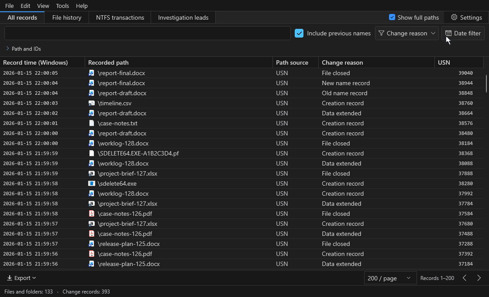
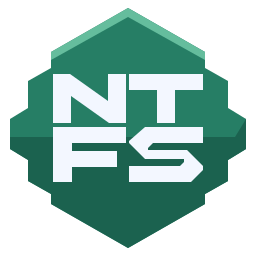

# NTFS Tracer

<h3 align="center">ディスクイメージから NTFS ログを直接解析できます。</h3>

<p align="center"><strong>Windows アプリひとつでファイル名を検索し、名前の変更、移動、削除の履歴を元のレコードまでたどれます。</strong></p>

<p align="center">USN ジャーナルの解析開始から最初のファイルの旧名を確認するまで、<strong>NTFS Log Tracker 1.9 の8倍以上の速さ</strong>でした。</p>

<p align="center">
  <a href="https://github.com/absolroot/NTFS-Tracer/releases/latest"></a>
  <a href="https://www.codefactor.io/repository/github/absolroot/ntfs-tracer/issues/main"></a>
  <a href="https://github.com/absolroot/NTFS-Tracer/actions/workflows/ci.yml"></a>
  <a href="LICENSE"></a>
</p>

[Windows x64・x86 版をダウンロード](https://github.com/absolroot/NTFS-Tracer/releases/latest) · [한국어](README.ko.md) · [English](README.md)

## NTFS Tracer を使う理由

- ディスクイメージから `$J`、`$MFT`、`$LogFile` を直接抽出して解析できます。
- 現在または変更前の名前で検索し、それぞれの USN レコードと元のバイト列を確認できます。
- 保存した調査を開き直すと、検索条件と選択したレコードが復元されます。

## 使い方

### アプリで調査する

Windows のアーキテクチャ (x64 または x86) に合った ZIP を展開し、`NtfsTracer.exe` を実行してください。通常版にはランタイムが含まれます。軽量版 (`shared-runtime`) には、同じアーキテクチャの .NET 10 Windows Desktop Runtime が必要です。

1. ファイルを指定せずに起動すると、**設定**画面が開きます。
   - **抽出済みのファイルがある場合**は、`$J`、`$MFT`、`$LogFile` のいずれか、またはそれらを含むフォルダーを選び、**解析を開始**を押します。ウィンドウにドラッグして指定することもできます。
   - **ディスクイメージがある場合**は、イメージを選ぶと、読み取り可能な最初の NTFS ボリュームが自動で選択されます。対象のボリュームと抽出するファイルを確認し、解析を開始します。
2. **全レコード**でファイルを検索し、該当する行から**ファイル履歴**を開きます。`$LogFile` を開いた場合は、**NTFS トランザクション**で記録を調べられます。
3. レコードを選ぶと、変更理由、パスの根拠、元のファイル内の位置が表示されます。`F1` でアプリ内ガイドを開けます。

中断する前に **ファイル → 調査を保存…** を選びます。次回起動時に **前回の調査を再開** を選ぶと、保存した資料、検索条件、選択したレコードに戻れます。

### USN ジャーナルを CSV に保存する

配布 ZIP を展開したフォルダーで次のコマンドを実行します。入力には USN V2 レコードのみを含む `$J` を使い、出力先には新しいファイル名を指定してください。

```powershell
.\ntfstracer-cli.exe usn-csv '.\$J' '.\usn.csv'
```

## 調査機能

[](docs/media/full-app-walkthrough-dark.gif)

- **変更ジャーナルを検索**. 現在や過去の名前、パス、ファイル参照番号で対象を探します。USN レコードは期間や変更理由で絞り込めます。
- **ファイルの変更履歴をたどる**. 検索結果からファイル履歴を開きます。名前の変更や移動について、変更前後の値とそれぞれの根拠を確認できます。収集時点の MFT で補ったパスには、その出典が表示されます。
- **トランザクションで変更前後を比較**. トランザクションログで LSN を検索します。Undo と Redo の両方に値があれば、ファイルの時刻を比較できます。
- **調査候補と根拠を確認**. 名前が繰り返し変更された後に削除されたファイルや、SDelete 関連の記録、時刻の変更などの候補を調べます。候補ごとに根拠となるレコードを開けます。

個々のレコードは詳細フィールド、Hex、JSON で確認できます。検索結果は CSV に出力でき、入力ファイルから USN やトランザクションの残存レコードを探すこともできます。

## 対応する入力

### ディスク・証拠イメージ

| 形式 | 拡張子 | 対応 |
| --- | --- | :---: |
| RAW | `.raw`, `.img`, `.dd`, `.000` / `.001` | ✓ |
| 物理 EWF | `.e01`, `.ex01` | ✓ |
| 論理 EWF | `.l01`, `.lx01` | ✓ |
| QCOW / QCOW2 | `.qcow`, `.qcow2`, `.qcow3` | ✓ |
| VHD / VHDX | `.vhd`, `.vhdx` | ✓ |
| VMDK | `.vmdk` | ✓ |
| AFF1 | `.aff` | ✓ |

物理イメージには読み取れる NTFS ボリュームが必要です。分割イメージは先頭のファイルを選び、BitLocker でロックされたボリュームは事前に解除します。[形式別の対応条件](modules/EvidenceImage/README.md)

### 抽出済みの資料と既存の結果

| 入力 | 対応 |
| --- | :---: |
| `$J` / `$UsnJrnl:$J` | ✓ |
| `$MFT` | ✓ |
| `$LogFile` | ✓ |
| NTFS Log Tracker の `.db`、`.sqlite`、`.sqlite3`、`.csv`、`.tsv` | ✓ |

パスを補完するには、同じボリュームの `$MFT` を `$J` または `$LogFile` と一緒に開きます。TSV を選ぶには、ファイル選択画面で **すべてのファイル** を表示します。

証拠ファイルは読み取り専用で開きます。抽出したファイルと SQLite インデックスは別の場所に保存します。既定の保存先は `%LOCALAPPDATA%\NtfsTracer` です。旧版の JournalDesk から更新した場合は、既存の設定とインデックスを引き続き使えます。

## 調査例とツールの比較

### 現在のファイル名から変更前の名前を調べる

収集した資料に `report-final.docx` があり、以前はどの名前で保存されていたかを調べたいとします。二つのツールで同じ USN ジャーナル（`$J`）を開きました。NTFS は変更前と変更後の名前を別々のレコードに記録するため、同じファイルの記録をたどる必要があります。

| ツール | 変更前の名前を調べた手順 |
| --- | --- |
|  **NTFS Tracer** | 以前の名前を含める設定を有効にして `report-final.docx` を検索し、ファイル履歴を開きました。同じファイルの記録が 5 件見つかり、ファイル履歴では変更前後の名前が一つの名前変更として表示されました。 |
|  **[NTFS Log Tracker 1.9](https://sites.google.com/site/forensicnote/ntfs-log-tracker)** | **File/Directory Name** で `report-final.docx` を検索すると、2 件の記録が見つかりました。結果から NTFS のファイル識別子である **FileReferenceNumber** をコピーし、名前の条件を消してその番号で検索し直しました。変更前の名前を含む 5 件が見つかりました。 |

どちらのツールでも、変更前の名前は **`report-draft.docx`** でした。下の画面では、NTFS Tracer が変更前後の名前と、その根拠となる二つの USN レコードを表示しています。

[](docs/media/file-history-dark.png)

**変更前の名前が表示されるまでの時間**

22 GiB の RAW ディスクイメージから抽出した USN ジャーナル（92.34 MiB、378,975 件）で同じ手順を試しました。同じ Windows PC で両ツールに同じジャーナルを読み込ませ、各 6 回の測定の中央値を求めました。2 回目の検索では、ジャーナルを開いたまま別のファイルの変更前の名前を調べました。

| 測定区間 | NTFS Tracer 0.8.32 | NTFS Log Tracker 1.9 |
| --- | ---: | ---: |
| 解析開始から最初の USN 一覧が表示されるまで | **1.95 秒** | 19.57 秒 |
| 解析開始から 1 件目のファイルの変更前の名前が分かるまで | **2.24 秒** | 20.01 秒 |
| ジャーナルを開いた状態で 2 件目のファイルの変更前の名前が分かるまで | **216 ms** | 356 ms |

2 件目の検索では、全 6 回で NTFS Tracer が先に結果を表示しました。変更前後の名前、USN、変更理由は両ツールで一致し、時刻も Tracker の表示精度まで一致しました。 [実験条件と全 6 回の測定値](docs/performance.md#previous-name-lookup-on-a-378975-record-journal) · [MFTECmd で上の例を照合した手順](docs/performance.md#cross-checking-the-demo-with-mftecmd)

## ビルド

[ビルド手順と依存関係](README.md#build-from-source) · [EWF ライブラリのビルド](modules/EvidenceImage/Logical/Native/README.md) · [リリース ZIP の作成](README.md#package-a-release)

## 表示言語

**表示 → 表示言語**で 16 種類の言語から選べます。変更はすぐに反映されます。

English · 한국어 · 日本語 · Deutsch · Español · Français · Bahasa Indonesia · Italiano · Polski · Português (Brasil) · Türkçe · Tiếng Việt · Русский · Українська · 简体中文 · 繁體中文

## ライセンス

プロジェクト独自のコードは [Apache License 2.0](LICENSE) の下で公開しています。

第三者のコンポーネントには、それぞれのライセンスが適用されます。[サードパーティーライセンス](THIRD-PARTY-NOTICES.md)
