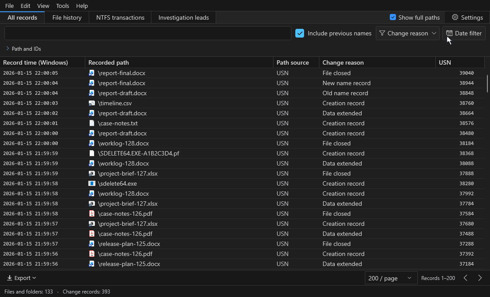
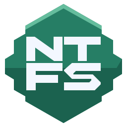
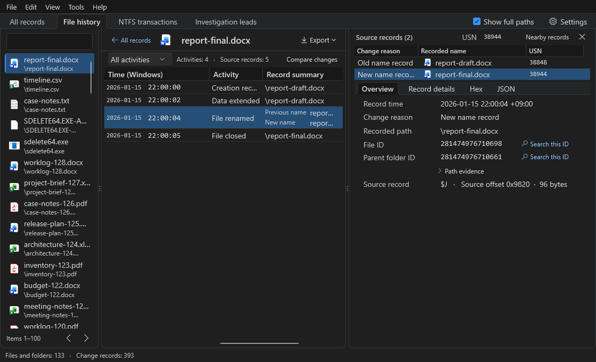

# NTFS Tracer

**NTFS 로그 분석은 빠르게, 파일의 변화는 한눈에.**

**NTFS Tracer는 NTFS 로그를 검색하고, 찾은 기록에서 파일의 변경 이력을 추적하는 Windows 포렌식 도구입니다.** Rust 엔진으로 USN 저널과 NTFS 트랜잭션 로그를 색인합니다. 파일 이력에서는 이름 변경·이동·삭제를 시간순으로 볼 수 있으며, 이름 변경 전후의 이름과 각각의 근거가 된 USN 기록을 한 항목에서 확인할 수 있습니다. NTFS Log Tracker로 만들어 둔 SQLite·CSV·TSV 결과도 읽기 전용으로 열 수 있습니다.

[Windows x64 다운로드](https://github.com/absolroot/NTFS-Tracer/releases/latest) · [English](README.md) · [日本語](README.ja.md)

## 왜 NTFS Tracer를 쓰나요?

- **디스크 이미지에서 NTFS 로그를 바로 가져옵니다.** 앱에서 이미지와 NTFS 볼륨을 선택하면 `$J`, `$MFT`, `$LogFile`을 추출해 분석할 수 있습니다. NTFS Log Tracker 1.9로 일반 로그를 분석하려면 다른 도구로 해당 파일을 먼저 추출해야 합니다. [Tracker 입력 형식](https://sites.google.com/site/forensicnote/ntfs-log-tracker)
- **검색 결과에서 파일 이력으로 바로 이동합니다.** 현재 파일명으로 찾은 행에서 **파일 이력 보기**를 선택하면 이전 이름과 근거 기록을 확인할 수 있습니다.
- **빠른 USN 검색과 파일 이력 확인.** Rust 엔진이 저널을 색인합니다. 일반 파일명 검색은 입력과 함께 시작되며, 파일 이력을 열면 선택한 원본 기록이 바로 표시됩니다. [대용량 저널 실험 결과](docs/performance.md#previous-name-lookup-on-a-378975-record-journal)
- **분석가의 작업 흐름을 고려했습니다.** 파일 아이콘으로 검색 결과에서 파일 종류를 한눈에 구분할 수 있습니다. 조사 후보에서 근거 기록을 바로 열고, 필요한 값을 복사할 수 있습니다. 조사를 다시 열면 저장한 검색 조건과 선택한 기록으로 돌아갈 수 있습니다.

## 시작하기

배포 ZIP의 압축을 푼 뒤 `NtfsTracer.exe`를 실행하세요. 경량판을 실행하려면 .NET 10 Windows Desktop Runtime(x64)이 필요합니다.

1. 처음 실행하면 **설정** 창이 열립니다. 준비한 자료에 따라 다음 방법으로 분석을 시작하세요.
   - **이미 추출한 자료가 있으면** `$J`, `$MFT`, `$LogFile` 또는 이 파일들이 들어 있는 폴더를 선택하고 **분석 시작**을 누르세요. 개별 파일이나 폴더를 창에 끌어 놓을 수도 있습니다.
   - **디스크 이미지가 있으면** 이미지 파일을 선택하세요. 읽을 수 있는 첫 번째 NTFS 볼륨이 자동으로 선택됩니다. 분석할 볼륨과 추출할 항목을 확인한 뒤 **추출 후 분석**을 누르세요.
2. **전체 로그**에서 파일을 검색하세요. 결과에서 파일 이력을 열면 이전 이름과 경로를 확인할 수 있습니다. `$LogFile`을 열었다면 **NTFS 트랜잭션** 탭에서 기록을 조회할 수 있습니다.
3. 기록을 선택하면 개요에 변경 사유, 경로를 판단한 근거, 원본 파일 안에서의 위치가 표시됩니다. `F1`을 누르면 사용 안내가 열립니다.

작업을 중단할 때는 **파일 → 조사 저장…**을 선택하세요. 다음 실행 때 **마지막 조사 이어서 열기**를 선택하면 저장한 자료와 검색 조건, 선택한 기록으로 돌아갈 수 있습니다. 앱은 원본의 SHA-256을 대조하고 사용할 수 있는 색인을 다시 엽니다.

## 조사 기능

[](docs/media/full-app-walkthrough-dark.gif)

- **변경 기록 검색**. 현재 이름이나 이전 이름, 경로, 파일 참조 번호로 대상을 찾습니다. 기간이나 변경 사유로 USN 기록을 좁힐 수 있습니다.
- **파일 하나의 변경 이력 추적**. 검색 결과에서 파일 이력을 엽니다. 이름이나 위치가 바뀐 경우에는 변경 전후와 각각의 근거 기록을 함께 봅니다. 수집 시점의 MFT로 경로를 보완한 경우에는 그 근거도 표시합니다.
- **트랜잭션의 변경 전후 비교**. 트랜잭션 로그에서 LSN으로 기록을 찾습니다. Undo와 Redo 양쪽에 값이 남아 있으면 파일 시각을 비교할 수 있습니다.
- **조사 후보와 근거 확인**. 반복해서 이름이 바뀐 뒤 삭제된 파일, SDelete 관련 기록, 파일 시각 변경 같은 후보를 확인합니다. 후보마다 연결된 근거 기록을 열 수 있습니다.

개별 기록은 상세 필드, Hex, JSON으로 확인할 수 있습니다. 결과를 CSV로 저장하거나, 입력 파일에서 USN 및 트랜잭션 기록의 잔여물을 찾을 수도 있습니다.

## 어떤 자료를 열 수 있나요?

| 자료 | 확인할 수 있는 내용 |
| --- | --- |
| `$J` | USN 변경 기록과 파일별 이력을 확인합니다. 파일 이력은 `$J`만 있어도 볼 수 있습니다. |
| `$MFT` | 같은 볼륨에서 추출한 `$J` 또는 `$LogFile`과 함께 열면 파일과 폴더의 경로를 보완할 수 있습니다. |
| `$LogFile` | 트랜잭션 기록, 로그 순서 번호(LSN), Redo·Undo 정보를 확인합니다. |
| NTFS Log Tracker의 SQLite DB·CSV·TSV | **파일** 메뉴에서 기존 결과를 읽기 전용으로 열어 검색할 수 있습니다. TSV 파일을 고를 때는 파일 선택 창에서 **모든 파일**을 선택하세요. |

디스크 이미지에서는 NTFS 볼륨을 선택하면 분석에 필요한 파일을 추출할 수 있습니다. 논리 증거 이미지에서는 이미 수집된 파일 목록에서 필요한 자료를 고릅니다.

| 이미지 형식 | 지원 범위 |
| --- | --- |
| RAW | 단일 NTFS 볼륨, MBR·GPT 디스크, `.000`이나 `.001`부터 번호가 이어지는 분할 이미지 |
| E01·Ex01 | 물리 디스크 이미지. 분할 이미지에서는 첫 파일을 선택하세요. 암호화되었거나 bzip2로 압축된 이미지는 열 수 없습니다. |
| L01·Lx01 | 논리 증거 이미지. 수집된 목록에서 분석할 NTFS 파일을 선택하세요. |
| QCOW·QCOW2 | 독립형 QCOW1과 표준 L2 테이블을 사용하는 QCOW2 v2·v3 |
| VHD·VHDX | 고정·동적 VHD와 독립형 VHDX |
| VMDK | 단일 희소(sparse) 이미지, 스트림 최적화 이미지, 같은 폴더의 FLAT 파일을 참조하는 디스크 설명자 |
| AFF1 | 무압축 페이지, zlib 압축 페이지 또는 0으로 채운 페이지를 담은 단일 이미지 |

잠겨 있는 BitLocker 볼륨은 외부 도구에서 잠금을 해제한 뒤 열 수 있습니다. 이미지 형식별 세부 조건은 [이미지 모듈 안내](https://github.com/absolroot/NTFS-Tracer/blob/v0.8.32/modules/EvidenceImage/README.md)에서 확인할 수 있습니다.

앱은 원본을 읽기 전용으로 열고, 추출한 파일과 SQLite 색인은 별도 경로에 저장합니다. 기본 저장 위치는 `%LOCALAPPDATA%\NtfsTracer`입니다. 기존 JournalDesk에서 사용한 설정과 색인도 이어서 사용할 수 있습니다.

## 조사 예시와 도구 비교

### 현재 파일명으로 이전 이름 찾기

수집한 자료에서 `report-final.docx`를 발견했습니다. 이 파일이 예전에 어떤 이름으로 저장됐는지 알아보기 위해 같은 USN 저널(`$J`)을 두 도구에서 열었습니다. NTFS는 이전 이름과 새 이름을 별도 기록에 남기므로, 현재 이름으로 찾은 기록에서 같은 파일의 이전 기록까지 따라가야 합니다.

| 도구 | 이전 이름을 찾은 방법 |
| --- | --- |
|  **NTFS Tracer** | **이전 이름 포함**을 켜고 `report-final.docx`를 검색한 뒤 **파일 이력 보기**를 선택했습니다. 검색에서 같은 파일의 기록 5건을 찾았고, 파일 이력에서는 이름 변경 한 건에 이전 이름과 새 이름이 함께 표시됐습니다. |
|  **[NTFS Log Tracker 1.9](https://sites.google.com/site/forensicnote/ntfs-log-tracker)** | **File/Directory Name**으로 `report-final.docx`를 검색해 기록 2건을 찾았습니다. 결과에서 NTFS가 파일을 식별하는 **FileReferenceNumber**를 복사하고 이름 조건을 지운 뒤, 그 번호로 다시 검색해 이전 이름이 포함된 기록 5건을 찾았습니다. |

두 도구에서 이전 이름이 **`report-draft.docx`**였음을 확인했습니다. 아래 화면에는 NTFS Tracer가 이름 변경 전후를 한 항목으로 표시하고 각각의 USN 기록을 연결한 모습이 나옵니다.

[](docs/media/file-history-dark.png)

**이전 이름을 찾기까지 걸린 시간**

22GiB RAW 디스크 이미지에서 추출한 USN 저널(92.34MiB, 378,975건)에서 같은 절차를 실행했습니다. 두 도구에 같은 저널을 넣고 같은 Windows PC에서 각각 6회 측정한 결과의 중앙값입니다. 두 번째 조회에서는 저널을 열어 둔 상태에서 다른 파일의 이전 이름을 찾았습니다.

| 측정 구간 | NTFS Tracer 0.8.32 | NTFS Log Tracker 1.9 |
| --- | ---: | ---: |
| 분석 시작부터 첫 USN 목록 표시까지 | **1.95초** | 19.57초 |
| 분석 시작부터 첫 번째 파일의 이전 이름 확인까지 | **2.24초** | 20.01초 |
| 저널을 열어 둔 상태에서 두 번째 파일의 이전 이름 확인 | **216ms** | 356ms |

두 번째 조회에서는 6회 모두 NTFS Tracer가 먼저 결과를 표시했습니다. 두 도구에서 이전 이름과 새 이름, USN, 변경 사유가 일치했고, 시각도 Tracker가 표시하는 정밀도까지 일치했습니다. [실험 조건과 6회 측정값](docs/performance.md#previous-name-lookup-on-a-378975-record-journal) · [MFTECmd로 위 예제의 원본을 대조한 방법](docs/performance.md#cross-checking-the-demo-with-mftecmd)

### 트랜잭션에서 파일 시각 값 확인하기

`$LogFile`에서 의심스러운 트랜잭션을 찾았다면 파일의 생성 시각이나 수정 시각이 바뀌었는지 확인할 수 있습니다. NTFS Tracer의 **NTFS 트랜잭션** 탭에서 LSN(로그 순서 번호)으로 기록을 찾고 **파일 속성 시각**을 확인하세요. Undo와 Redo 양쪽에 값이 남아 있으면 생성, 내용 수정, 메타데이터 변경, 마지막 접근 시각을 변경 전후로 비교할 수 있습니다.

ArtiFast Windows의 제품 안내에서는 Windows LogFile 목록에서 LSN을 찾은 뒤, 해당 행을 선택해 원본 오프셋과 트랜잭션 ID, Redo·Undo 작업을 확인합니다. [ArtiFast의 Windows LogFile 조사 예시](https://forensafe.com/blogs/windowslogfile.html)

## 소스에서 빌드하기

Windows x64 환경에 .NET 10 SDK, Rust MSVC 도구 체인, Visual Studio C++ Build Tools를 설치하세요. 코드 검사를 실행하려면 Rust의 `rustfmt`와 `clippy`도 필요합니다.

```powershell
cargo build --release --locked --manifest-path engine/Cargo.toml
dotnet publish gui/NtfsTracer.csproj -c Release -p:PublishProfile=Portable -o artifacts/portable
./lint.ps1
```

EWF 이미지를 열 수 있는 배포본을 만들려면 `NtfsTracer.libewf.dll`을 빌드한 뒤 `modules/EvidenceImage/Logical/Native/`에 두고 다시 게시하세요. [libewf 빌드 방법](https://github.com/absolroot/NTFS-Tracer/blob/main/modules/EvidenceImage/Logical/Native/README.md)

소스는 Rust 색인 엔진, WPF 앱, 이미지 판독 모듈로 구성됩니다. [엔진](https://github.com/absolroot/NTFS-Tracer/tree/v0.8.32/engine) · [WPF 앱](https://github.com/absolroot/NTFS-Tracer/tree/v0.8.32/gui) · [이미지 모듈](https://github.com/absolroot/NTFS-Tracer/tree/v0.8.32/modules/EvidenceImage) · [회귀 검사](https://github.com/absolroot/NTFS-Tracer/tree/v0.8.32/tests)

## 표시 언어

**보기 → 표시 언어**에서 16개 언어 중 하나를 선택할 수 있습니다. 선택한 언어는 즉시 적용됩니다.

English · 한국어 · 日本語 · Deutsch · Español · Français · Bahasa Indonesia · Italiano · Polski · Português (Brasil) · Türkçe · Tiếng Việt · Русский · Українська · 简体中文 · 繁體中文

## 라이선스

프로젝트 자체 코드는 PolyForm Noncommercial 1.0.0에 따라 공개합니다. 영리 기업이 내부 조사에 사용하거나, 고객을 대상으로 유료 조사를 수행하거나, 상용 제품에 포함하려면 사전에 서면 허가를 받아야 합니다. [프로젝트 라이선스](LICENSE)

허가를 요청하려면 GitHub 이슈에 사용 목적과 연락 방법을 적어 주세요. 공개 이슈에는 사건 정보나 증거를 올리지 마세요. [상업적 이용 문의](https://github.com/absolroot/NTFS-Tracer/issues/new)

외부 구성 요소에는 각 구성 요소의 라이선스가 적용됩니다. [외부 구성 요소와 라이선스](THIRD-PARTY-NOTICES.md)
